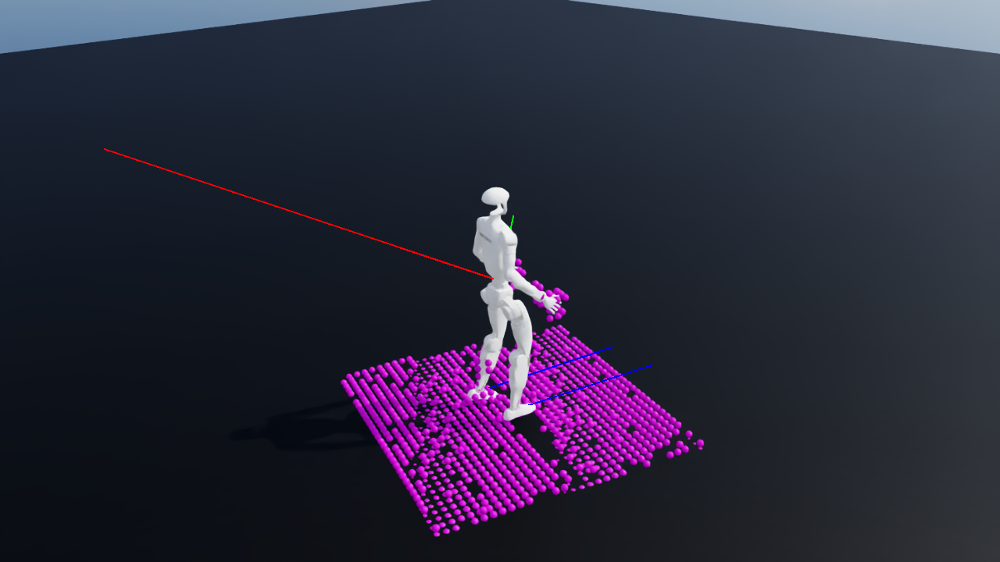

# G1 Gallant 地形导航仿真与训练

基于官方 [Gallant](https://github.com/InternRobotics/Gallant) 和 [Active Adaptation](https://github.com/btx0424/active-adaptation)，使用 Isaac Sim / Isaac Lab 运行 G1 的激光雷达体素感知与 PPO 地形导航训练。

已验证 32 环境短训练、检查点保存与加载、无界面仿真和图形回放。仓库附带的 `checkpoints/smoke_final.pt` 经过 3072 帧短训练，供验证运行链路；稳定导航和上下楼梯需要继续训练。

```bash
git clone https://github.com/wzhou0804/g1_gallant.git
cd g1_gallant
./scripts/setup.sh --seed /home/zhouwei/Documents/go2_omniverse
./scripts/train.sh total_frames=3072 checkpoint_interval=1
./scripts/verify_sim.sh checkpoints/smoke_final.pt
./scripts/play.sh checkpoints/smoke_final.pt
```

安装入口需要本机 Isaac Sim 5.1 / Isaac Lab 2.3.2 种子环境：种子目录内包含 `.cache-g1/python311` 和 `.venv-g1-sim`。脚本复制独立 Python 与包，再下载固定提交的上游源码并应用补丁。虚拟环境、下载的上游源码和运行缓存由安装脚本在本地生成。

完整环境配置、训练参数、继续训练与兼容修复说明见 [中文使用文档](README_ZH.md)。上游版本见 [sources.json](sources.json)，验证记录见 [训练](logs/training_verification.json)、[无界面仿真](logs/simulation_verification.json)和[图形仿真](logs/simulation_verification_gui.json)。记录中的绝对路径对应首次验证时的本机目录。


